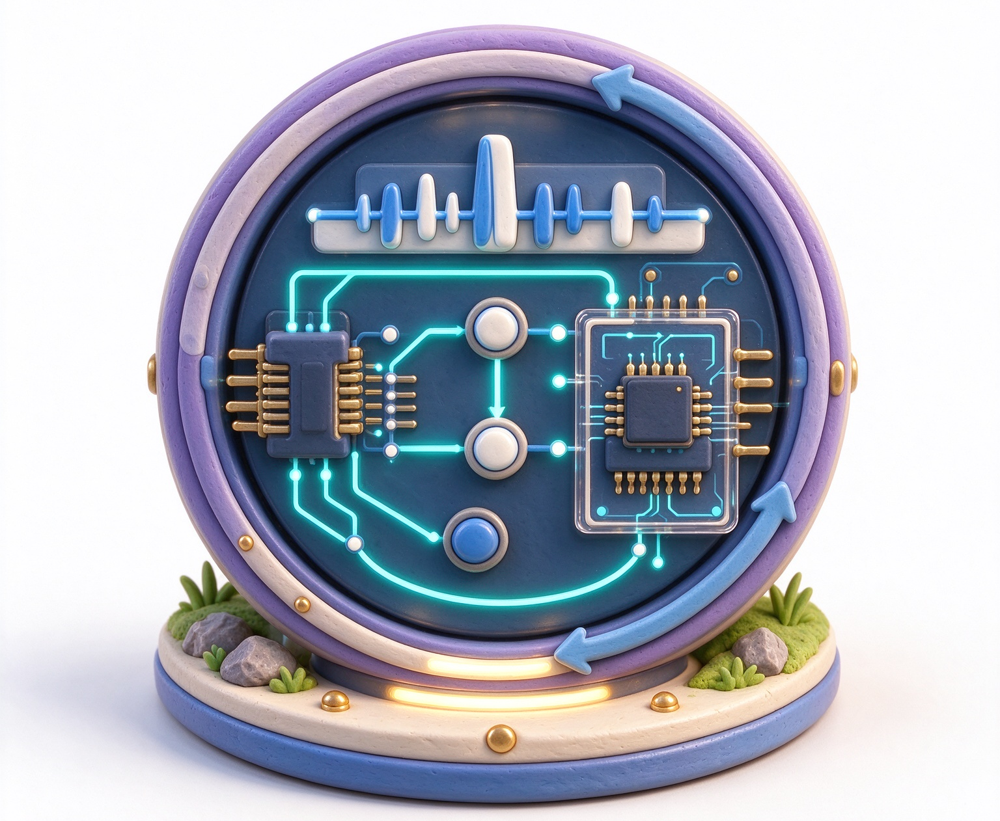
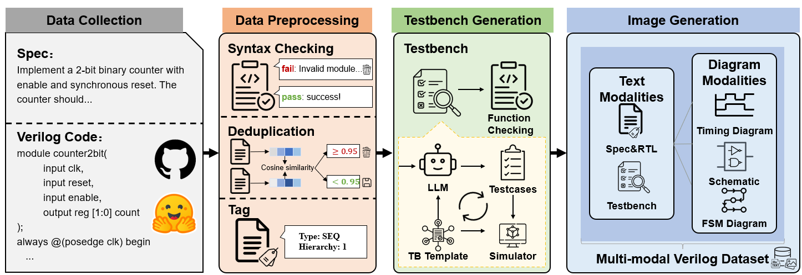
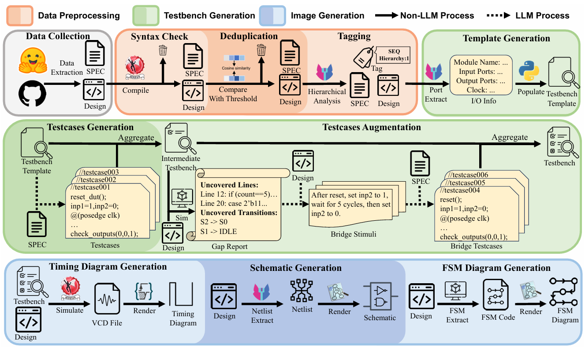
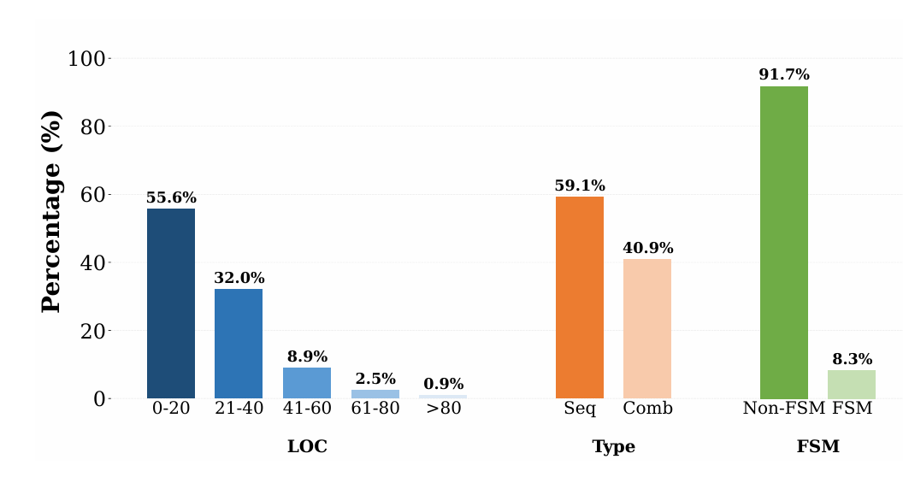
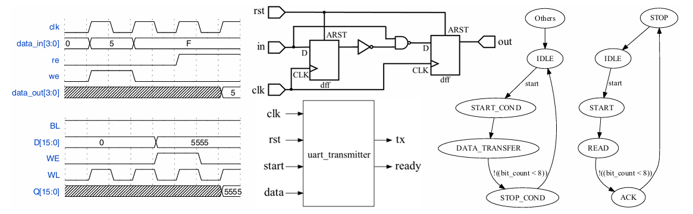

<div align="center">
  

  <h1>VeriMM</h1>

  <h3>A Large-Scale Multimodal Verilog Dataset with High-quality Testbenches for Hardware Code Generation</h3>

  <p>
    <a href="mailto:22447018@zju.edu.cn">Siyu Yun</a> ·
    <a href="mailto:thetree2021@163.com">Qingsong Peng</a> ·
    <a href="mailto:li.yu@zju.edu.cn">Yu Li</a><sup>✉</sup> ·
    <a href="mailto:czhuo@zju.edu.cn">Cheng Zhuo</a><br>
    Zhejiang University<br />
    Accepted by ICCAD 2026
  </p>
  

  <p>
    <a href="docs/VeriMM.pdf"><strong>Paper</strong></a> |
    <a href="https://doi.org/10.1145/3831252.3834170"><strong>DOI</strong></a> |
    <a href="#overview"><strong>Overview</strong></a> |
    <a href="#dataset-statistics"><strong>Statistics</strong></a> |
    <a href="#dataset-organization"><strong>Dataset Organization</strong></a> |
    <a href="#citation"><strong>Citation</strong></a>
  </p>

  <p>
    
    
    
    
  </p>
</div>

> VeriMM is a large-scale multimodal Verilog dataset for hardware code generation. Each sample couples natural language specifications with RTL implementations, executable testbenches, and hardware-oriented visual representations including timing diagrams, schematics, and FSM diagrams.

## Overview

Existing hardware-code datasets often lack reliable verification and multimodal grounding. VeriMM addresses both issues with a fully automated construction pipeline that filters and validates Verilog designs, generates high-quality testbenches, and synthesizes specification-aligned visual artifacts.

VeriMM contains **57,304** verified Verilog designs covering both combinational and sequential circuits. Beyond the dataset itself, this repository also includes the end-to-end pipeline for data preprocessing, testbench generation, and image generation.

### Why VeriMM?

| Large-scale | Verification-aware | Multimodal |
| --- | --- | --- |
| 57K+ Verilog samples with rich annotations and circuit metadata | Template-based testbench generation with coverage-driven refinement | Text descriptions, RTL code, testbenches, schematics, waveforms, and FSM diagrams |
| Suitable for dataset curation, supervised fine-tuning, and benchmarking | Achieves **F1 = 0.8253** for bug detection while reducing token cost by **99%** compared to the prior best method | Improves hardware code generation by grounding models in realistic hardware documentation |

### Highlights

- **57,304 verified samples** with natural language descriptions, RTL code, and executable testbenches.
- **Three visual modalities**: circuit schematics, simulation waveforms, and FSM diagrams.
- **Strong verification quality**: the construction pipeline achieves **0.8253 F1** in bug detection.
- **Efficient data generation**: the proposed workflow reduces token usage by **99%** compared with the prior best testbench-generation method.
- **Downstream gains**: models trained on VeriMM's verification-enforced data show up to **21.3%** higher functional pass rate, and visual grounding brings an average **15.4%** improvement.

## Construction Pipeline

The full construction process contains three major stages: **data preprocessing**, **testbench generation**, and **image generation**.

<p align="center">
  
</p>

This simplified flow highlights how VeriMM is built from paired specifications and Verilog code, then cleaned, verified, and extended into multimodal training data.

<p align="center">
  
</p>

The pipeline starts from open-source Verilog repositories, performs syntax checking and deduplication, tags circuit properties, generates template-based testbenches, refines stimuli using coverage gaps, and finally produces aligned visual representations for each verified design.

## Dataset Statistics

<p align="center">
  
</p>

| Category | Count |
| --- | ---: |
| Total annotated samples | 57,304 |
| Sequential circuits | 33,846 |
| Combinational circuits | 23,458 |
| Schematic diagrams | 45,351 |
| Waveform diagrams | 18,224 |
| FSM diagrams | 2,140 |

### Circuit Hierarchy Distribution

| Hierarchy Depth | Count |
| --- | ---: |
| 1 (single module) | 57,145 |
| 2 | 144 |
| 3 | 4 |
| 5 | 3 |
| 6 | 7 |
| 7 | 1 |

## Visual Modalities

VeriMM provides multiple views of the same hardware design to better match real-world engineering workflows.

<p align="center">
  
</p>

- **Waveforms** expose temporal behavior and expected signal transitions.
- **Schematics** reveal structural relationships between hardware components.
- **FSM diagrams** capture control-flow behavior for sequential logic.

## Dataset Organization

```text
VeriMM-Dataset/
|-- annotations/                    # JSONL files with design annotations
|   |-- chunk_1.jsonl
|   |-- chunk_2.jsonl
|   `-- ...                         # 200 chunk files, ~57K entries total
|-- images/                         # Circuit diagram images and per-sample assets
|   |-- <hash_prefix>/              # Two-character hex prefix (00-c9)
|   |   `-- <sample_id>/            # Per-sample directory
|   |       |-- code.v              # Verilog source code
|   |       |-- testbench.v         # Testbench code
|   |       |-- spec.txt            # Design specification
|   |       |-- schematic.png       # Circuit schematic diagram
|   |       |-- waveform.png        # Simulation waveform (if applicable)
|   |       `-- fsm.png             # FSM state diagram (if applicable)
|   `-- ...
|-- pipeline_scripts/               # Scripts used to build the dataset
|   |-- data_preprocessing/         # Data cleaning and annotation
|   |   |-- deduplicate.py          # Semantic deduplication using FAISS
|   |   |-- syntax_check.py         # Verilog syntax validation (iverilog/Yosys)
|   |   |-- tag_circuit_type.py     # Label circuits as sequential/combinational
|   |   `-- tag_hierarchy.py        # Compute module hierarchy depth via Yosys
|   |-- image_generation/           # Circuit diagram rendering
|   |   |-- fsm_generation.py       # FSM diagram generation using Verdi and Graphviz
|   |   |-- schematic_generation1.py  # Schematic generation via netlist JSON to SVG
|   |   |-- schematic_generation2.py  # Schematic generation via Yosys and Graphviz
|   |   |-- timing_diagram_generation.py  # Waveform rendering from VCD simulation
|   |   `-- vcd2wavedrom.py         # VCD to WaveDrom JSON converter
|   `-- testbench_generation/       # Automated testbench creation
|       |-- analyze_rtl.py          # RTL analysis using Yosys
|       |-- coverage_gap_report.py  # Coverage gap reporting via URG
|       |-- insert_testcases.py     # Insert generated testcases into testbench templates
|       |-- tb_pipeline_iter.py     # Iterative coverage-driven testbench generation pipeline
|       `-- template_generation.py  # Testbench template generator
`-- README.md
```

## Annotation Format

Each line in the annotation JSONL files is a JSON object with the following fields:

| Field | Type | Description |
| --- | --- | --- |
| `description` | string | Natural language description of the circuit functionality |
| `code` | string | Verilog RTL source code implementing the design |
| `testbench` | string | Executable Verilog testbench for simulation and verification |
| `circuit_hierarchy` | integer | Module hierarchy depth (`1` means a single-module design) |
| `type` | string | Circuit type: `"sequential"` or `"combinational"` |

<details>
<summary>Example annotation entry</summary>

```json
{
  "description": "Design a simple PCIe request-response controller that handles incoming requests and generates appropriate responses...",
  "code": "module pcie_controller ( ... ); ...",
  "circuit_hierarchy": 1,
  "type": "sequential",
  "testbench": "`timescale 1ns/1ps ..."
}
```

</details>

## Quick Start

Load the annotations in Python:

```python
import json

samples = []
for i in range(1, 201):
    with open(f"annotations/chunk_{i}.jsonl", "r", encoding="utf-8") as f:
        for line in f:
            samples.append(json.loads(line))

print(f"Loaded {len(samples)} samples")
```

## License

- **Source code**: Apache-2.0 License
- **Dataset content** (Verilog designs, testbenches, and visual diagrams): CC-BY 4.0

## Citation

If you use VeriMM in your research, please cite:

```bibtex
@inproceedings{yun2026verimm,
  title={VeriMM: A Large-Scale Multimodal Verilog Dataset with High-quality Testbenches for Hardware Code Generation},
  author={Yun, Siyu and Peng, Qingsong and Li, Yu and Zhuo, Cheng},
  booktitle={Proceedings of the IEEE/ACM International Conference on Computer-Aided Design (ICCAD)},
  doi={10.1145/3831252.3834170},
  year={2026}
}
```
